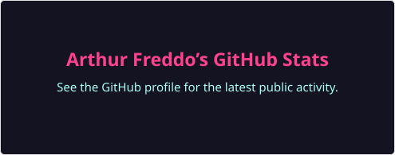
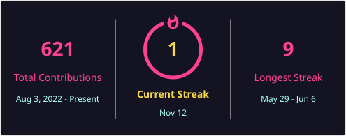

<table align="center">
  <tr>
    <td align="center">
      
    </td>
    <td align="center">
      
    </td>
    <td align="center">
      
    </td>
  </tr>
</table>

---

### 📫 How to reach me:

  
  

---

### 👨‍💻 About Me:

- 🔭 I am currently working at **StarApp Sistemas**
- 🌱 I am currently learning **Node.js** with **Typescript**
- 🎓 I am in the final year of **Computer Engineering** at **Unoesc**

---

### 💼 Tech Stack:

  <code></code>
  <code></code>
  <code></code>
  <code></code>
  <code></code>
  <code></code>
  <code></code>
  <code></code>
  <code></code>

---

### 📊 My GitHub Stats & Projects

  
  

  <a href="https://github.com/ArthurFreddo?tab=overview#js-contribution-activity">Contribution activity</a>
  ·
  <a href="https://github.com/ArthurFreddo?tab=repositories">Public repositories</a>

---

  

  

---
